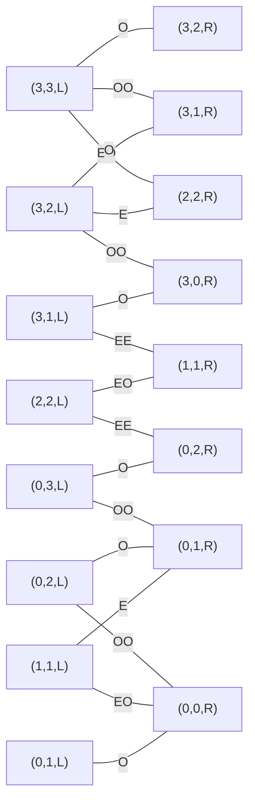

# Blatt 01 – Problemlösen und Suche

## Search.01 – Problemformalisierung

Ein Zustand wird als

$$
(e,o,p)
$$

beschrieben. Dabei sind $e$ und $o$ die Elben und Orks am linken Ufer. Für das Pferd gilt $p\in\{L,R\}$. Am rechten Ufer befinden sich damit $3-e$ Elben und $3-o$ Orks.

Ein Zustand ist erlaubt, wenn an beiden Ufern kein Elf in der Unterzahl ist:

$$
(e=0\lor o\le e)\land(3-e=0\lor 3-o\le 3-e).
$$

Start- und Zielzustand sind

$$
(3,3,L)\qquad\text{und}\qquad(0,0,R).
$$

Das Pferd kann mit einem oder zwei Wesen fahren. Die möglichen Belegungen sind

$$
(1,0),\ (2,0),\ (0,1),\ (0,2),\ (1,1).
$$

Eine Aktion ist nur möglich, wenn die Personen am Ufer des Pferdes stehen und der neue Zustand erlaubt ist.

### Problemgraph

`E` steht für einen Elben und `O` für einen Ork. Die Beschriftung einer Kante gibt die Fahrt von links nach rechts an. Rückwärts fahren dieselben Personen wieder zurück.

Eine kürzeste Lösung benötigt elf Fahrten:

1. `OO` nach rechts
2. `O` zurück
3. `OO` nach rechts
4. `O` zurück
5. `EE` nach rechts
6. `EO` zurück
7. `EE` nach rechts
8. `O` zurück
9. `OO` nach rechts
10. `E` zurück
11. `EO` nach rechts

## Search.02 – Suchverfahren

Der Zieltest erfolgt beim Entnehmen aus der Datenstruktur. Nachfolger werden alphabetisch geordnet.

### Tiefensuche (Graph Search)

Gefundener Weg:

$$
\text{Würzburg}\rightarrow\text{Frankfurt}\rightarrow\text{Kassel}\rightarrow\text{München}
$$

- maximale Stackgröße: **3**
- Schleifendurchläufe: **5**
- Kosten: $217+173+502=892$ km

### Breitensuche (Graph Search)

Gefundener Weg:

$$
\text{Würzburg}\rightarrow\text{Nürnberg}\rightarrow\text{München}
$$

- maximale Queuegröße: **4**
- Schleifendurchläufe: **7**
- Kosten: $103+167=270$ km

### A* (Tree Search ohne Zyklen)

Es gilt $f(n)=g(n)+h(n)$.

| Schritt | entnommener Weg | $g$ | $h$ | $f$ |
|---:|---|---:|---:|---:|
| 1 | WÜ | 0 | 170 | 170 |
| 2 | WÜ–F | 217 | 100 | 317 |
| 3 | WÜ–F–MA | 302 | 200 | 502 |
| 4 | WÜ–F–MA–KA | 382 | 10 | 392 |
| 5 | WÜ–ER | 186 | 400 | 586 |
| 6 | WÜ–F–MA–KA–A | 632 | 0 | 632 |
| 7 | WÜ–N | 103 | 537 | 640 |
| 8 | WÜ–N–MÜ | 270 | 0 | 270 |

Ergebnis: Würzburg – Nürnberg – München mit **270 km**.

- maximale Größe der Prioritätsqueue: **4**
- Schleifendurchläufe: **8**

### Zulässigkeit der Heuristik

Für eine zulässige Heuristik muss $h(n)\le h^*(n)$ gelten. Nur der Wert für Nürnberg verletzt diese Bedingung:

$$
h(\text{Nürnberg})=537>167=h^*(\text{Nürnberg}).
$$

Der Wert wird deshalb auf 167 km korrigiert. Danach ergibt A*:

| Schritt | entnommener Weg | $g$ | $h$ | $f$ |
|---:|---|---:|---:|---:|
| 1 | WÜ | 0 | 170 | 170 |
| 2 | WÜ–N | 103 | 167 | 270 |
| 3 | WÜ–N–MÜ | 270 | 0 | 270 |

- Weg: **Würzburg – Nürnberg – München**
- Kosten: **270 km**
- maximale Größe der Prioritätsqueue: **4**
- Schleifendurchläufe: **3**

| Verfahren | Weg | Kosten | max. Frontier | Durchläufe |
|---|---|---:|---:|---:|
| Tiefensuche | WÜ–F–KAS–MÜ | 892 km | 3 | 5 |
| Breitensuche | WÜ–N–MÜ | 270 km | 4 | 7 |
| A*, ursprüngliche Heuristik | WÜ–N–MÜ | 270 km | 4 | 8 |
| A*, korrigierte Heuristik | WÜ–N–MÜ | 270 km | 4 | 3 |

## Search.03 – Dominanz

Eine zulässige Heuristik $h_1$ dominiert eine zulässige Heuristik $h_2$, wenn für alle Knoten

$$
h_1(n)\ge h_2(n)
$$

gilt. $h_1$ liefert damit mindestens so genaue Restkostenschätzungen. A* expandiert mit $h_1$ normalerweise nicht mehr Knoten als mit $h_2$.

Ein Beispiel ist $h_2(n)=0$. Die korrigierte Heuristik aus Search.02 dominiert diese Nullheuristik. Die perfekte Heuristik $h^*(n)$ dominiert wiederum jede andere zulässige Heuristik.

## Search.04 – Optimalität von A*

Sei $C^*$ der Preis einer optimalen Lösung. Solange diese Lösung noch nicht gefunden wurde, liegt ein Knoten $n$ des optimalen Pfades in der Frontier. Wegen der Zulässigkeit gilt

$$
f(n)=g(n)+h(n)\le g(n)+h^*(n)=C^*.
$$

Angenommen, A* würde zuerst ein nicht optimales Ziel $Z$ mit Kosten $C>C^*$ entnehmen. Für ein Ziel ist $h(Z)=0$, also

$$
f(Z)=g(Z)=C>C^*.
$$

In der Frontier liegt aber noch ein Knoten des optimalen Pfades mit $f(n)\le C^*$. Da A* immer den kleinsten $f$-Wert entnimmt, müsste dieser Knoten vor $Z$ gewählt werden. Das ist ein Widerspruch. Daher ist A* als Tree Search mit einer zulässigen Heuristik optimal.

## Bonus – Möglichkeiten und Grenzen von KI

Computer und Roboter lösen bereits viele klar eingegrenzte Aufgaben, zum Beispiel Routenplanung, Übersetzung, Qualitätskontrolle oder das Erkennen bestimmter Objekte. Autonome Fahrzeuge funktionieren ebenfalls, aber nur in festgelegten Gebieten und unter bestimmten Bedingungen. Seltene Situationen, schlechtes Wetter oder unklare Anweisungen bleiben schwierig.

LLMs können Texte schreiben, zusammenfassen und beim Programmieren helfen. Ihre Antworten können aber auch plausibel klingen und trotzdem falsch sein. Deshalb müssen wichtige Ergebnisse überprüft werden. Weitere Probleme sind Verzerrungen in den Trainingsdaten, Datenschutz, Urheberrecht und der hohe Energiebedarf großer Rechenzentren.

Vorteile sind unter anderem weniger Routinearbeit, neue Assistenzsysteme und mehr Mobilität. Gleichzeitig müssen Haftung, Kontrolle und Verantwortung geklärt sein. KI ist deshalb vor allem für begrenzte Aufgaben geeignet; eine verantwortliche Person bleibt notwendig.

### Quellen

- [NIST: Generative AI Profile](https://doi.org/10.6028/NIST.AI.600-1)
- [Yakura et al.: Influence of LLMs on spoken communication](https://arxiv.org/abs/2409.01754)
- [IEA: Energy and AI](https://www.iea.org/reports/energy-and-ai/energy-demand-from-ai)
